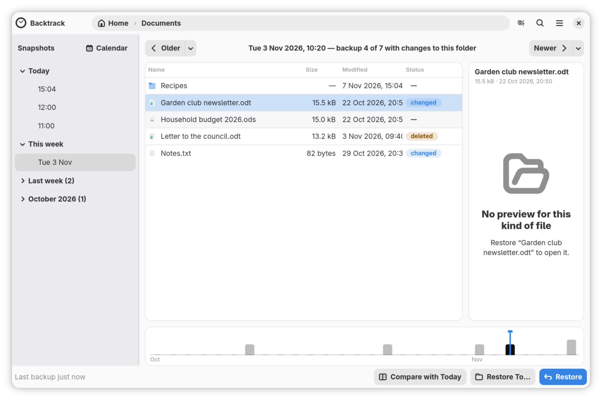
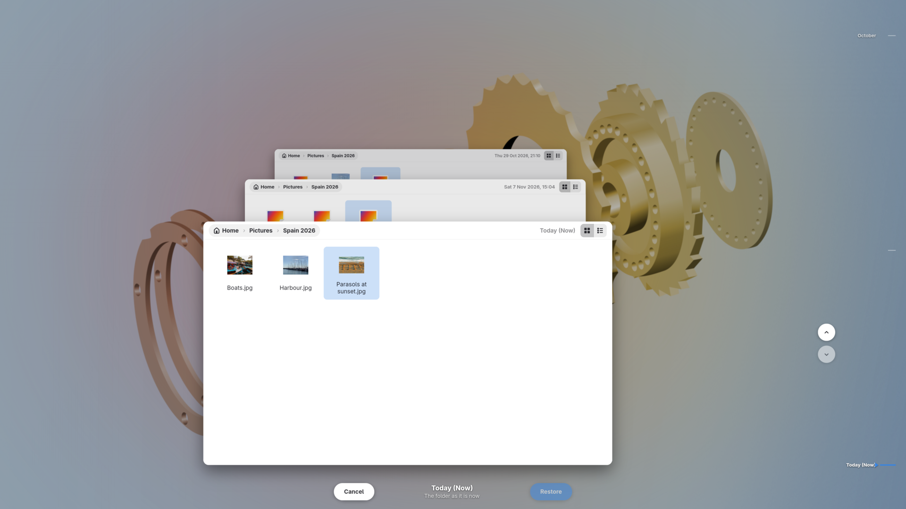
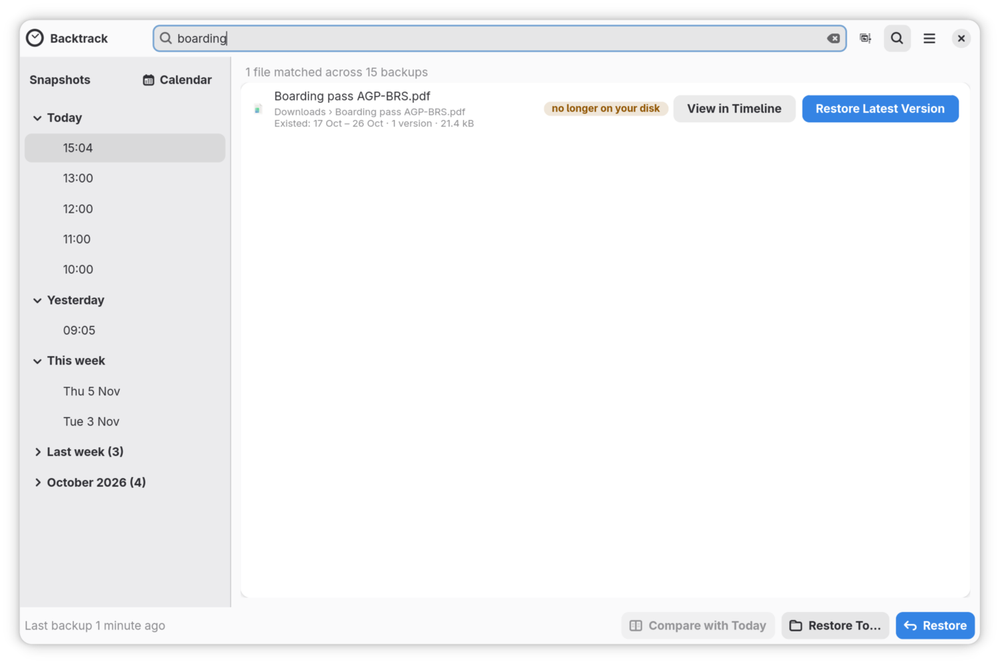
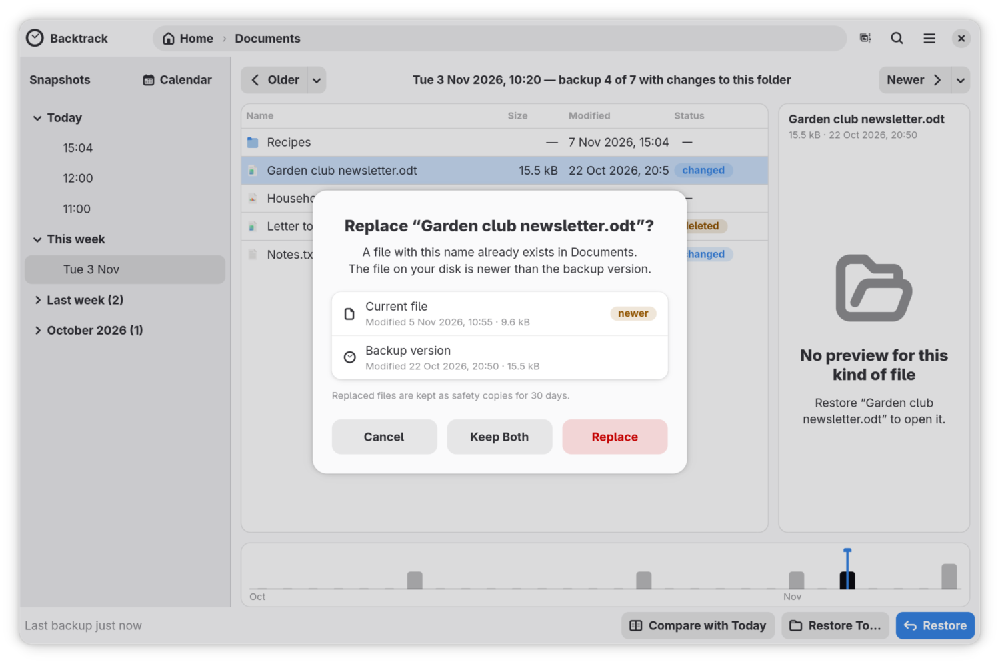
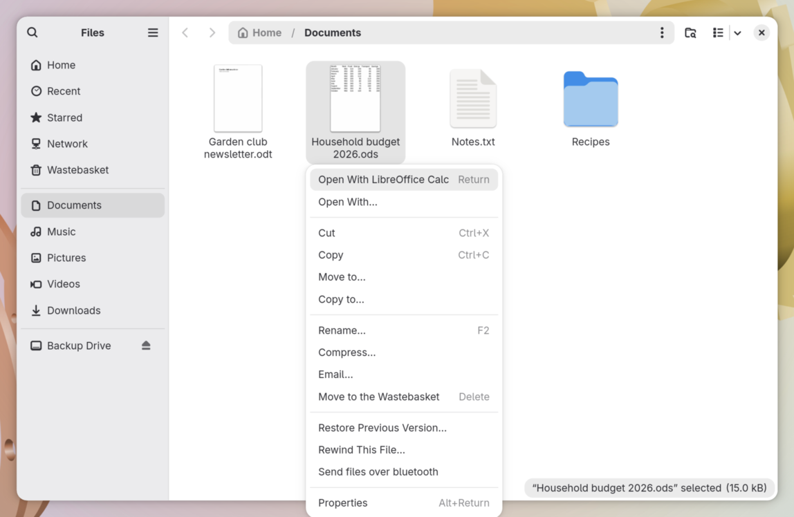

<p align="center">
  
</p>

<h1 align="center">Backtrack</h1>

<p align="center"><b>Browse your files as they were.</b></p>

Backtrack backs up your files every hour. When one goes missing or gets
spoiled, you open its folder as it was this morning, or last Tuesday, find the
file, and bring it back. It runs on GNOME, KDE Plasma and other Linux desktops,
and keeps your backups encrypted with Borg on a USB drive, a network folder or
a server over SSH.

https://github.com/user-attachments/assets/738dac90-f916-4377-80e7-518608e668ea

> [!NOTE]
> <picture><source media="(prefers-color-scheme: dark)" srcset="assets/readme/friendly-manifesto-badge-white.svg" /></picture> <br>
> This project voluntarily adheres to The Friendly Manifesto. Read more [here](https://friendlymanifesto.org)

## Features

### Go back to any backup

Open a folder, pick a backup from the list on the left, and Backtrack shows the
folder as it was then. Files that have gone since are marked deleted, and files
that differ are marked changed. A preview shows a file as it was.

<p align="center">
  <picture>
    <source media="(prefers-color-scheme: dark)" srcset="docs/images/window-earlier-backup-dark.png" />
    
  </picture>
</p>

### Rewind

Rewind fills the screen with a folder as it is now, its backups stretching away
behind it, and a timeline down the side. Press ↑ to go back one backup at a
time, then select a file and click Restore to bring it back.

<p align="center">
  
</p>

### Search every backup

Type part of a file's name and Backtrack looks through every backup at once.
Files that are no longer on your computer come first, with the folder each was
in and when it existed.

<p align="center">
  
</p>

### A restore can't make things worse

- When a file is in the way, Backtrack shows when each copy was last changed,
  and which is newer, before you choose.
- With **Keep Both**, the backup's version takes the name, and yours stays
  beside it with "(current)" added.
- Until you restore something else, the bar under the window's header offers
  **Undo**, which puts everything back as it was.
- Every file a restore replaces goes to Recently Replaced Files, and stays
  there for up to thirty days.

<p align="center">
  
</p>

### At home on GNOME and KDE

Right-click a file or folder in GNOME Files or Dolphin to rewind it or browse
its backups. On desktops with a tray, its icon tells you how backups stand. The
`backtrack` command backs up, searches and restores from a terminal or a
script, and everything works from the keyboard, with Orca reading every
control.

<p align="center">
  
</p>

---

## Backups that look after themselves

| | |
| :--- | :--- |
| **Every hour** | While you're logged in, Backtrack backs up once an hour without you pressing anything. |
| **Asleep** | A computer that slept through a backup catches up as soon as it wakes. |
| **On battery** | It waits for the charger, for up to three hours after the last backup, then backs up anyway. |
| **On a metered connection** | It waits, on a phone's hotspot for example, until you are back on an unmetered network. |
| **Drive away** | Backtrack keeps your changes on this computer, small and encrypted, and sends them on when the drive is back. |
| **Between backups** | Files you put in the Trash, and Snapper's snapshots on btrfs, show up in the timeline too. |
| **Quiet** | It says nothing unless something needs you. Then you get a banner in the window and a notification with a Fix… button. |

## Yours to keep

| | |
| :--- | :--- |
| **Borg underneath** | Your backups are BorgBackup repositories, encrypted on this computer before they leave it and deduplicated, so each hour stores only what changed. If Backtrack vanished tomorrow, Borg alone could still open them. |
| **A recovery key** | When you set it up, you save a copy of your backups' key. If the copy kept with the backups is ever damaged, the recovery key and your passphrase open them again. |
| **No telemetry** | Your backups go where you send them, and nothing else leaves your computer. |
| **Your files, not your system** | Your documents, pictures, music, downloads and desktop, with your app settings and your SSH and GPG keys. The system itself is for Timeshift, or Snapper on btrfs. |
| **Free software** | GPL-3.0-or-later, and all of it is on GitHub. |

---

## Installing

[Install Backtrack](docs/installing.md) walks through each way, step by step.

| Where | How |
| :--- | :--- |
| Any distribution | [The Flatpak, from FriendlyHub](docs/installing.md#any-distribution-the-flatpak) |
| Fedora 44 and later | COPR: `sudo dnf copr enable keithvassallo/backtrack`, then `sudo dnf install backtrack` |
| Ubuntu 26.04 and later | PPA: `sudo add-apt-repository ppa:keithvassallomt/backtrack`, then `sudo apt install backtrack` |
| Arch Linux | AUR: `yay -S backtrack` |

The native packages have the file managers' integrations as `backtrack-nautilus`
and `backtrack-dolphin`; the Flatpak installs them from Preferences.

## Guides

[Backtrack's guides](docs/README.md) walk you through using it, one task at a
time: setting up your backups, getting a file back, moving to a new computer,
and more.

## Development

Backtrack needs GTK 4.22 and libadwaita 1.9 (GNOME 50), so it builds on Fedora
44, Ubuntu 26.04 and Arch, or newer, and uses
[`just`](https://github.com/casey/just) as its task runner.

```sh
git clone https://github.com/keithvassallomt/backtrack.git
cd backtrack
just setup    # installs system deps (GTK4, libadwaita, SQLite, D-Bus, borg) + Rust
just check    # fmt, clippy and tests: the full quality gate
```

`just` on its own lists every recipe. Development runs (`just run-daemon`,
`just run-app`) use `BACKTRACK_DEV=1` so they never touch real backups or logs.

The implementation plan, architecture and design docs live in
[`backtrack_plan/`](backtrack_plan/README.md). Start with the
[product brief](backtrack_plan/reference/brief.md) and the
[architecture](backtrack_plan/reference/stack.md); task status is tracked in
[`backtrack_plan/progress.md`](backtrack_plan/progress.md).

## License

GPL-3.0-or-later. See [LICENSE](LICENSE).
