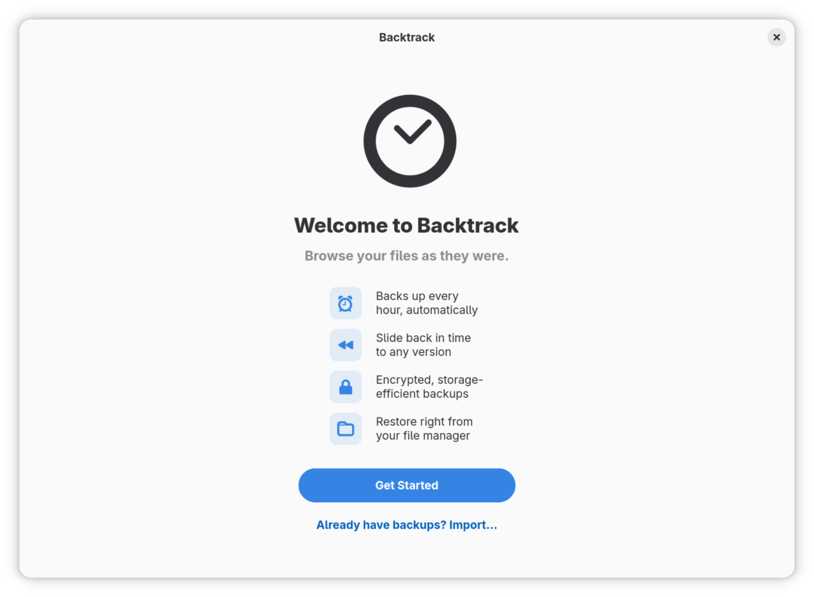
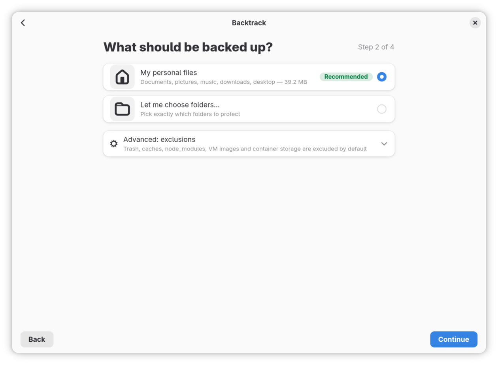
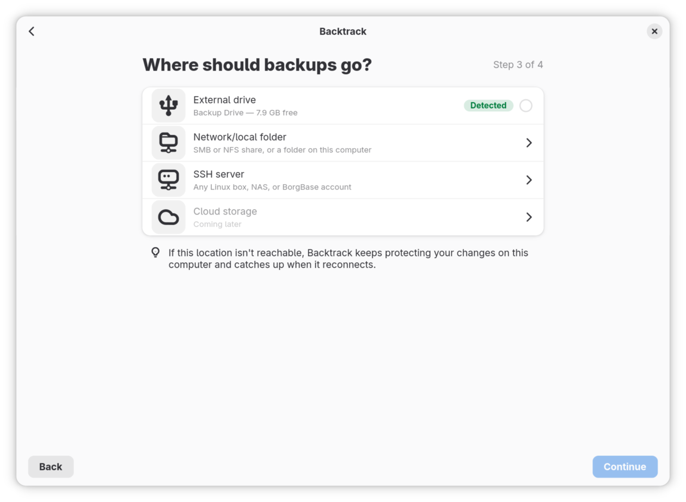
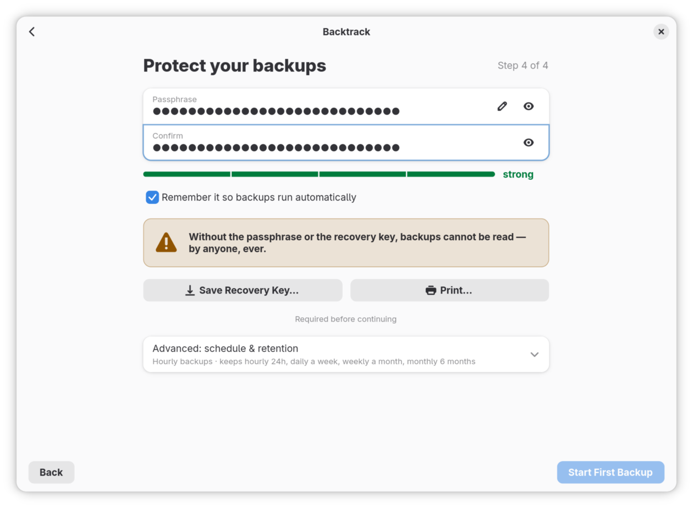
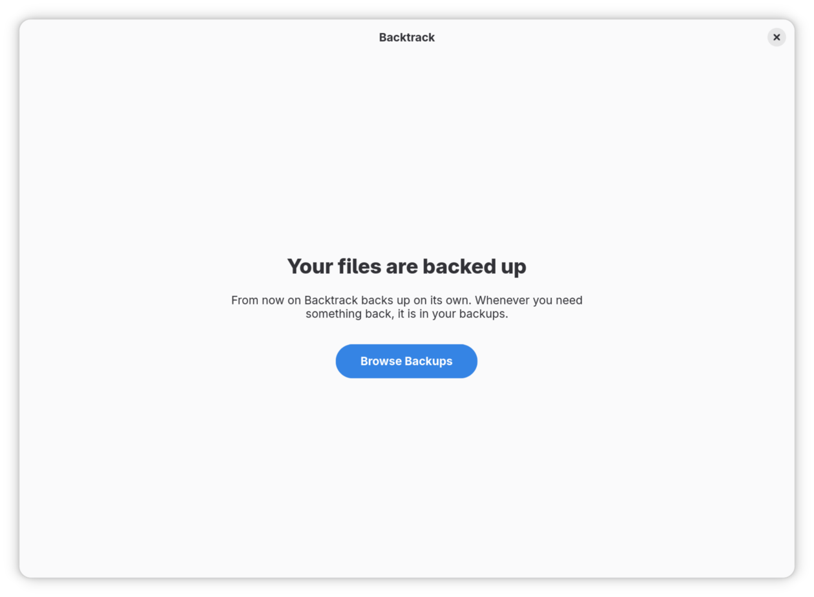

# Set up your backups

The first time you open Backtrack, a short wizard sets up your backups: what
to back up, where to keep the backups, and the passphrase that locks them. It
ends with your first backup finished. From then on, Backtrack backs up on its
own.

## Before you start

- Backtrack is installed. [Install Backtrack](installing.md) says how.
- You have somewhere to keep the backups, with more free space than the
  files you are backing up:
  - an external drive;
  - a network folder, such as a shared folder on a NAS or another computer;
  - or an SSH server, which needs your SSH key set up first: see [Set up an
    SSH key for a server](#set-up-an-ssh-key-for-a-server).

## Set up your backups

1. Plug in the drive you are backing up to, if that is where the backups are
   going, and open Backtrack. You see **Welcome to Backtrack**. Click **Get
   Started**.

   

2. **What should be backed up?** asks what to back up. **My personal files**
   is chosen already: your documents, pictures, music, downloads and desktop.
   To pick the folders yourself, choose **Let me choose folders…** instead.
   **Advanced: exclusions** says what Backtrack leaves out: the Trash, caches
   and other files you would never want back. Click **Continue**.

   

3. **Where should backups go?** asks where to keep them. Choose one:
   - For a drive: it is listed as **External drive**, marked **Detected**,
     with its name and its free space. Click it.
   - For a network folder: click **Network/local folder**, type the shared
     folder's address, such as `smb://nas.local/backups`, and click
     **Connect**. The folder button beside the address lets you choose a
     folder instead, such as a shared folder your file manager has opened.
   - For an SSH server: click **SSH server**, type the address, such as
     `sam@nas.local:backups`, and click **Test Connection**.

   Then click **Continue**. On a drive or a network folder, Backtrack keeps
   the backups in a folder named **Backtrack**, inside which each computer
   has a folder of its own.

   

4. **Protect your backups** asks for a passphrase. Your backups are
   encrypted with it, so nobody without it can read them. Type it in
   **Passphrase** and again in **Confirm**. The bar under them says how
   strong it is; aim for **strong**. A few unrelated words make a passphrase
   that is strong and still easy to remember.

   Leave **Remember it so backups run automatically** ticked. Backtrack then
   keeps the passphrase in your keyring and backs up without asking for it.

5. Save the recovery key. Click **Save Recovery Key…** and save the file, or
   click **Print…** and print it. Backtrack does not carry on until you have
   done one of them.

   The recovery key is a copy of the key your backups are locked with. If the
   copy kept with the backups is ever damaged, the recovery key and your
   passphrase open them again. It does not replace your passphrase: you need
   both. Keep it somewhere other than this computer and the backup drive: in
   a password manager, on a USB stick you keep elsewhere, or printed on
   paper.

   

6. Check the schedule. **Advanced: schedule & retention** shows it: a backup
   every hour, keeping the hourly ones for a day, one a day for a week, one a
   week for a month and one a month for six months. Open it to change it, or
   change it later in Preferences.

7. Click **Start First Backup**. **Backing up for the first time** shows how
   far it has got.

   The first backup copies everything you chose, so it is the slow one. With
   a large home folder, or a network folder or server as the destination, it
   can take hours. Once this page is showing, you can close the window and
   the backup carries on. Later backups copy only what changed since the one
   before, so they are much quicker.

8. When it has finished, you see **Your files are backed up**. Click
   **Browse Backups** to see them.

   

## Set up an SSH key for a server

Backtrack signs in to an SSH server with your SSH key, never a password, so
the key has to be set up before you choose the server in step 3. If you can
already sign in to the server with `ssh` without typing a password, skip
this.

1. Make an SSH key, if you have none. In a terminal, run:

   ```sh
   ssh-keygen -t ed25519
   ```

   Press **Enter** at each question. An empty passphrase lets Backtrack use
   the key without asking.
2. Copy the key to the server, using your account there:

   ```sh
   ssh-copy-id sam@nas.local
   ```

   The first time, it asks whether you trust the server: type `yes`. Then it
   asks for your password on the server, once.
3. Check that it worked: `ssh sam@nas.local` signs you in without a
   password. Type `exit` to leave.

For a service such as BorgBase, add your key in the service's own settings
instead, and use the address it gives you.

## What Backtrack does from now on

- Every hour it backs up what changed, with the window closed too.
- If the computer was asleep or off when a backup was due, the backup runs
  when it wakes.
- On a laptop running on battery, it waits for the charger, for up to three
  hours after the last backup, and then backs up on battery anyway.
- On a connection marked as metered, such as a phone's hotspot, it waits
  for an unmetered one.
- While the drive is unplugged, the files you change are kept on this
  computer, small and encrypted, as snapshots you can browse like backups.
  Backtrack sends them on when the drive is back.
- It tells you when it needs you, and only then, with a banner in the window
  and a notification: after a day without a backup, for example. [When
  Backtrack needs you](when-backtrack-needs-you.md) explains each one.

## Change your settings

Open the main menu and choose **Preferences**, or press **Ctrl+,**. What you
change applies at once. The settings are on five pages:

- **General**: whether Backtrack runs in the background, its notifications,
  the items in your file manager, and **Run Welcome Wizard Again…**, which
  sets everything up again and keeps your backups.
- **Backup**: how often to back up (**Every hour**, **Every day**, **Every
  week** or **Only when I ask**), **Back up on battery power**, how long to
  **Wait for mains power**, **Back up on metered connections**, what to back
  up and what to leave out.
- **Storage**: where the backups are, how many are kept, whether to **Keep
  protecting changes on this computer** while the destination is away and
  how much room that may take, and Snapper.
- **Security**: **Change Passphrase…**, **Remember passphrase**, and saving
  or printing the recovery key again.
- **Advanced**: **Verify Repository Health…**, which checks the backups for
  damage, as well as freeing up space, compression, limiting how fast
  Backtrack uploads, and its logs.

## Already have backups?

If you have backups already, from an earlier Backtrack or another computer,
open them instead of starting again.

1. On the welcome page, click **Already have backups? Import…**.
2. **Where are your backups?** asks where they are. Click **Choose
   Folder…** and choose the folder that holds them. For Backtrack's backups
   on a drive, that is the folder named after the computer they came from,
   inside the drive's **Backtrack** folder. For backups on an SSH server, type
   the address in **SSH server address** and click the tick at its end.
3. **Enter your passphrase** asks for the passphrase they were made with.
   Type it and click **Open Backups**.
4. **Welcome back. Restore this computer?** offers to bring your files back
   onto this computer. [Move to a new computer](new-computer.md) goes on from
   here.

Backtrack also opens backups made by Vorta or Pika Backup, which use Borg as
it does. You can browse them, search them and restore from them. Some need
something different in step 3:

- Backups made without a passphrase, such as Vorta's unencrypted ones and
  Pika Backup's made with **Continue Unencrypted**, open without asking for
  one.
- Backups whose key is in a key file, which Vorta offers, first ask you to
  **Choose the key file**. Borg keeps it on the computer that made the
  backups, in the hidden folder `.config/borg/keys` in the home folder. Copy
  it from there, choose it with **Choose Key File…**, and then type the
  passphrase.

If you carry on backing up into another program's backups, Backtrack thins
out only its own older backups and leaves the other program's alone.

## If it did not go as described

- **Your drive is not listed in step 3.** Plug it in and wait until your
  file manager shows it. If it is listed in the file manager but not in
  Backtrack, choose **Network/local folder** and pick the drive with the
  folder button.
- **Step 3 says "Existing Backtrack/Borg backup found — use it?"** There are
  backups there already. **Use It** carries on backing up into them, after
  asking for their passphrase. **Choose Another** goes back to choose
  somewhere else.
- **Test Connection says the server did not let Backtrack sign in.** Your
  SSH key is not set up for that server yet. Follow [Set up an SSH key for a
  server](#set-up-an-ssh-key-for-a-server), then try again.
- **Already have backups? says "No backups were found there."** The folder
  you chose holds the backups one level further down. Choose the folder
  named after the computer, inside **Backtrack**.

## Where to go next

[Get a file back from an earlier backup](restoring.md): find a file as it
was, and bring it back.
