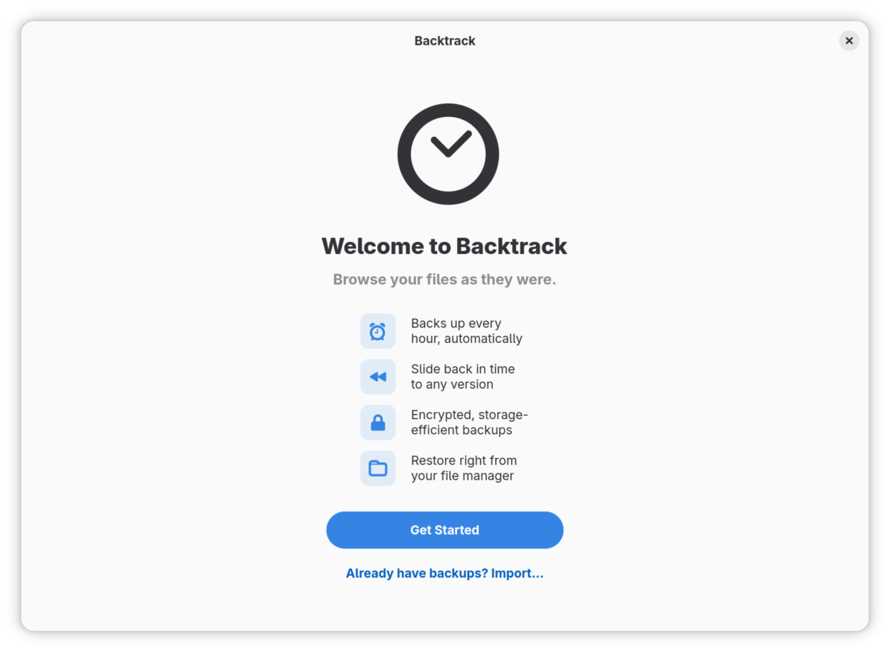

# Install Backtrack

The quickest way is one command, which works out the right way for your
computer. To install Backtrack yourself, the way depends on which Linux
distribution you use. Either way, at the end Backtrack is open at its welcome
page, ready to set up.

## The quick way: one command

1. Open a terminal: search your apps for **Terminal**.
2. Paste this command with **Ctrl+Shift+V** and press **Enter**:

   ```sh
   curl -fsSL https://backtrack.tools/install.sh | bash
   ```

3. It shows what it found, such as your distribution and your file manager,
   and the best way to install Backtrack on it. If it asks whether to add
   Backtrack to your file manager's right-click menu, press **Enter** for yes.
4. It shows its plan, with each command it will run, and asks **Go ahead?**
   Press **Enter**.
5. If it asks for a password, type it and press **Enter**. Nothing
   appears on the screen while you type.
6. When it says **Backtrack is installed**, it asks **Open Backtrack now?**
   Press **Enter**. You see **Welcome to Backtrack**.

[What the install script does](https://backtrack.tools/install-script/) goes
through the script line by line. To install Backtrack yourself instead, read
on.

## Which way to install

1. Find out which distribution you use, and its version.
   - On GNOME (Fedora, Ubuntu and many others), open **Settings**, choose
     **System**, then **About**. The line **Operating System Name** names it,
     for example *Fedora Linux 45 (Workstation Edition)*.
   - On KDE Plasma, open **System Settings** and choose **About this
     System**. The line **Operating System** names it.
2. Find your distribution in this table, and follow the steps it points to.

   | Your distribution | How to install Backtrack |
   |---|---|
   | Fedora 44 or later | [From COPR](#fedora-from-copr) |
   | Ubuntu 26.04 or later | [From the PPA](#ubuntu-from-the-ppa) |
   | Arch Linux | [From the AUR](#arch-linux-from-the-aur) |
   | Any other, or an older Fedora or Ubuntu | [The Flatpak](#any-distribution-the-flatpak) |

   Backtrack's own packages need the libraries that came with GNOME 50. The
   Flatpak brings everything it needs with it, so it also runs on older
   distributions such as Debian 13 and RHEL 10, and on Fedora, Ubuntu and
   Arch if you prefer it. Install Backtrack one way only.

Some steps are commands for a terminal. To open one, search your apps for
**Terminal**. Paste a command with **Ctrl+Shift+V** and press **Enter**. A
command that starts with `sudo` asks for your password first; nothing appears
on the screen while you type it, so type it and press **Enter**.

## Fedora: from COPR

1. Add Backtrack's repository. In a terminal, run:

   ```sh
   sudo dnf copr enable keithvassallo/backtrack
   ```

   It explains that this repository is not part of Fedora, and asks **Is
   this ok [y/N]:**. Type `y` and press **Enter**.
2. Install Backtrack:

   ```sh
   sudo dnf install backtrack
   ```

   It lists what it will install and asks **Is this ok [y/N]:** again. Type
   `y` and press **Enter**. On GNOME the list includes `backtrack-nautilus`,
   which adds Backtrack's items to GNOME Files; on Plasma it includes
   `backtrack-dolphin`, which adds them to Dolphin.
3. Search your apps for **Backtrack** and open it. You see **Welcome to
   Backtrack**.

   

## Ubuntu: from the PPA

1. Add Backtrack's repository. In a terminal, run:

   ```sh
   sudo add-apt-repository ppa:keithvassallomt/backtrack
   ```

   It describes the repository and says **Press [ENTER] to continue or
   Ctrl-c to cancel**. Press **Enter**.
2. Install Backtrack:

   ```sh
   sudo apt install backtrack
   ```

   It lists what it will install, Borg included, and asks **Continue?
   [Y/n]**. Press **Enter**.
3. Search your apps for **Backtrack** and open it. You see **Welcome to
   Backtrack**.

On Ubuntu, the items Backtrack adds to the file manager come in a package of
their own. [Add Backtrack to your file manager's
menu](file-manager-integration.md) says how to install it.

## Arch Linux: from the AUR

1. Install Backtrack. With an AUR helper such as yay or paru:

   ```sh
   yay -S backtrack
   ```

   Without a helper, build it with `makepkg` and install only the main
   package. `makepkg -si` would also install the GNOME Files and Dolphin
   packages, and with them what both file managers need.

   ```sh
   sudo pacman -S --needed git base-devel
   git clone https://aur.archlinux.org/backtrack.git
   cd backtrack
   makepkg -s
   sudo pacman -U backtrack-[0-9]*.pkg.tar.zst
   ```

2. Search your apps for **Backtrack** and open it. You see **Welcome to
   Backtrack**.

The items for GNOME Files and Dolphin are the AUR's `backtrack-nautilus` and
`backtrack-dolphin`. [Add Backtrack to your file manager's
menu](file-manager-integration.md) has the details.

## Any distribution: the Flatpak

1. Make sure Flatpak is installed. Fedora has it already, as do RHEL 10 and
   its rebuilds such as AlmaLinux and Rocky Linux. On Ubuntu and Debian, run
   this in a terminal, and press **Enter** when it asks **Continue? [Y/n]**:

   ```sh
   sudo apt install flatpak
   ```

2. Install Backtrack:

   ```sh
   flatpak install --user https://dl.friendlyhub.org/repo/appstream/tools.backtrack.Backtrack.flatpakref
   ```

   Backtrack comes from FriendlyHub, and the GNOME runtime it runs on comes
   from Flathub. Flatpak may ask whether to keep FriendlyHub for future
   installations, whether to add Flathub, and whether to install the
   runtime, and then asks whether to go ahead. Press **Enter** at each
   question to answer yes. The first time, the runtime is a download of
   several hundred megabytes.
3. If Flatpak was new to this computer, log out and back in. Flatpak adds its
   apps to your list of apps when you log in, so Backtrack is not there
   until then.
4. Search your apps for **Backtrack** and open it. You see **Welcome to
   Backtrack**.

### Network folders on desktops other than GNOME

The Flatpak reaches network folders (`smb://` and `nfs://` addresses) through
GVfs, a part of GNOME that other desktops, Plasma among them, often leave
out. Drives work without it, and so does a network folder you have mounted
some other way, which you can choose like any other folder. When Backtrack
needs GVfs, the setup wizard says so and gives the command that installs it.
Open Backtrack again once it is installed.

## Updating

Backtrack updates with the rest of your system.

- On Fedora and Ubuntu, the system's own updates include it, whether you
  install them from the software centre or from the update notification.
- On Arch Linux, update it as you update other AUR packages, for example with
  `yay -Syu`.
- For the Flatpak, run `flatpak update`. A software centre that handles
  Flatpaks, such as GNOME Software, updates it with everything else.

## Uninstalling

Uninstalling Backtrack leaves your backups where they are. The rest of what
stays is under [What stays behind](#what-stays-behind).

### Fedora

1. Close Backtrack's window if it is open.
2. Run `sudo dnf remove backtrack`, and answer **Is this ok [y/N]:** with
   `y`. The items in GNOME Files or Dolphin go with it, as does the part of
   Backtrack that runs in the background.

### Ubuntu

1. Run `sudo apt purge backtrack`, and press **Enter** at **Continue?
   [Y/n]**. The items in the file manager go with it, as does the entry that
   started Backtrack when you logged in.
2. Run `sudo apt autoremove` to remove Borg as well, unless something else
   uses it.
3. Log out and back in. The part of Backtrack that runs in the background
   keeps running until you do.

### Arch Linux

1. Run `sudo pacman -Rs backtrack`, adding `backtrack-nautilus` or
   `backtrack-dolphin` if you installed them.
2. Log out and back in.

### The Flatpak

1. Stop Backtrack, including the part that runs in the background:

   ```sh
   flatpak kill tools.backtrack.Backtrack
   ```

   If it says that Backtrack is not running, carry on.
2. Uninstall it with its settings:

   ```sh
   flatpak uninstall --user --delete-data tools.backtrack.Backtrack
   ```

   It asks two questions, whether to uninstall it and whether to delete its
   data. Answer **y** to both.
3. Remove the entry that started Backtrack when you logged in:

   ```sh
   rm ~/.config/autostart/tools.backtrack.Backtrack.desktop
   ```

4. If no other Flatpak app uses the GNOME runtime, remove it too:

   ```sh
   flatpak uninstall --user --unused
   ```

### What stays behind

- Your backups stay where Backtrack was saving them. On a drive or a network
  folder, that is a folder named **Backtrack** with a folder inside for each
  computer; on an SSH server, it is the address you gave. To open them again,
  install Backtrack and choose **Already have backups? Import…** on its
  welcome page. To get rid of them, delete that folder.
- Your passphrase stays in your keyring as **Backtrack backup passphrase**,
  if you let Backtrack remember it. A keyring app can delete it: Passwords
  and Keys on GNOME, KWalletManager on Plasma.
- With the Fedora, Ubuntu and Arch packages, Backtrack's settings stay in the
  hidden folder `.local/share/backtrack` in your home folder, along with its
  catalogue of your backups and its logs. To delete them:

  ```sh
  rm -r ~/.local/share/backtrack
  ```

  Borg, the program Backtrack backs up with, also keeps notes about your
  backups, in `.config/borg` and `.cache/borg`. Leave those if you use
  another Borg program, such as Vorta. The Flatpak keeps all of this inside
  its own data, which step 2 deleted.

## If it did not go as described

- **Backtrack is not among your apps after installing the Flatpak.** Log out
  and back in. When Flatpak was installed just before Backtrack, your desktop
  only finds its apps from the next login.
- **`apt` says it is unable to locate the package backtrack.** Either adding
  the repository did not finish, or this Ubuntu is older than 26.04, for
  which the PPA has no packages. Run step 1 again and read what it says. On
  an older Ubuntu, install [the Flatpak](#any-distribution-the-flatpak)
  instead.
- **Uninstalling the Flatpak ends with "Directory not empty".** Backtrack was
  still running while its data was being deleted. The app itself is
  uninstalled; delete what is left of its data with
  `rm -r ~/.var/app/tools.backtrack.Backtrack`.

## Where to go next

[Set up your backups](getting-started.md): the welcome wizard, from choosing
what to back up to the first backup.
