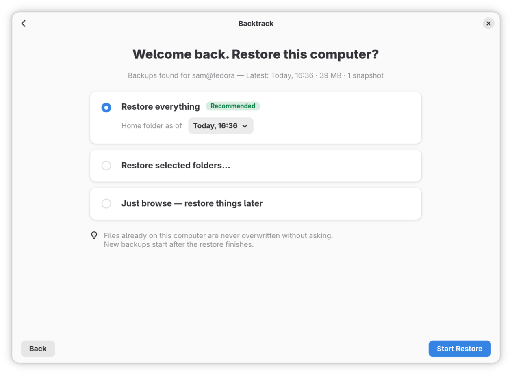

# Move to a new computer

When your old computer is lost, broken or simply replaced, your backups can
bring everything onto a new one. This guide installs Backtrack on the new
computer, opens your backups there, and restores your files, all of them or
the folders you choose. It ends with the new computer backing itself up.

## Before you start

- You can reach your backups from the new computer: the backup drive is
  plugged in, the network folder is open in the file manager, or, for an SSH
  server, your SSH key is set up on the new computer ([Set up an SSH key for
  a server](getting-started.md#set-up-an-ssh-key-for-a-server)).
- You know the passphrase your backups were made with. The recovery key
  cannot replace it.
- The new computer has room for your files. Backtrack checks before it
  starts, and says if it has not.

## Restore your files

1. Install Backtrack on the new computer. [Install Backtrack](installing.md)
   says how.
2. Open Backtrack. On **Welcome to Backtrack**, click **Already have backups?
   Import…**.
3. **Where are your backups?** asks where they are.
   - On a drive or a network folder, click **Choose Folder…**. Open the
     **Backtrack** folder, choose the folder named after your old computer
     inside it, and click **Choose**.
   - On an SSH server, type the address you used before, such as
     `sam@nas.local:backups`, in **SSH server address**, and click the tick at
     its end.
4. **Enter your passphrase** asks for the passphrase the backups were made
   with. Type it, leave **Remember it so backups run automatically** ticked,
   and click **Open Backups**.
5. **Welcome back. Restore this computer?** says whose backups these are and
   how recent the latest is. Choose one:
   - **Restore everything**, the recommended choice, brings back your whole
     home folder as it was at the latest backup. To go back further, choose
     an earlier backup beside **Home folder as of**. Click **Start Restore**.
   - **Restore selected folders…** lets you choose. Click **Choose
     Folders…**, untick what you do not want, and click **Start Restore**.
     **Settings and other files** are the hidden folders and loose files in
     your home folder, where programs keep their settings.
   - **Just browse — restore things later** restores nothing and opens the
     backups to look through. Click **Browse Backups**.

   

6. **Restoring Your Files** shows how far it has got, how much is left, and
   about how long it will take, folder by folder, smallest first. You can
   close the window and go on using the computer: the restore carries on,
   and opening Backtrack brings the window back. If the computer restarts,
   the restore carries on from where it was.

   To stop for a while, click **Pause**, and **Resume** to carry on.
7. When it has finished, you see **Your files are back**, with the number of
   files restored. Click **Open Backtrack**.

From then on, the new computer backs up on its own, into the same backups,
starting straight away. It backs up the folders your old computer did.

## Files that were already on the new computer

Backtrack never overwrites a file that is already on the new computer
without asking. If some of them differ from the backup's copies, the end of
the restore says how many, and offers **Choose Which to Keep…**.

1. Click **Choose Which to Keep…**. It says how many files would be
   replaced.
2. Choose one:
   - **Keep Both Versions** keeps the new computer's file and puts the
     backup's beside it.
   - **Replace Changed Files** puts the backup's copies in their place.
     **Review…** lists them first, so that you can untick any to leave as
     they are.
   - **Cancel** leaves the question for later.

Every file a restore replaces is kept for 30 days, in case you change your
mind.

## Stopping a restore

Click **Cancel** while it restores. **Stop restoring your files?** asks what
to do with what has been restored so far:

- **Continue Restoring** carries on.
- **Keep what's restored so far** stops and keeps it.
- **Discard** stops and takes away what it restored, leaving alone anything
  you have changed since.

Files that were on the new computer before are not touched either way, and
neither are your backups.

## If it did not go as described

- **"That passphrase does not open these backups."** Type the passphrase the
  backups were made with, which is not always the one you use elsewhere. If
  it is forgotten, the backups cannot be opened: the recovery key cannot
  bring back a passphrase.
- **"No backups were found there."** The folder you chose holds the backups
  one level further down. Choose the folder named after your old computer,
  inside **Backtrack**.
- **"Restoring needs about … and this computer has … free."** Choose
  **Restore selected folders…** and leave some out, or make room first.
- **Restoring stopped, with a reason.** Usually the backup drive was
  unplugged or the network went away. Put it right, then click **Try Again**:
  it carries on from where it stopped. A notification also says when a
  restore has stopped.
- **Back Up Now says backups start once this computer has been restored.**
  Backups wait for the restore to finish, so that they do not back up a
  half-restored home folder.

## Where to go next

[Get a file back from an earlier backup](restoring.md), for when you need
one file as it was rather than everything.
