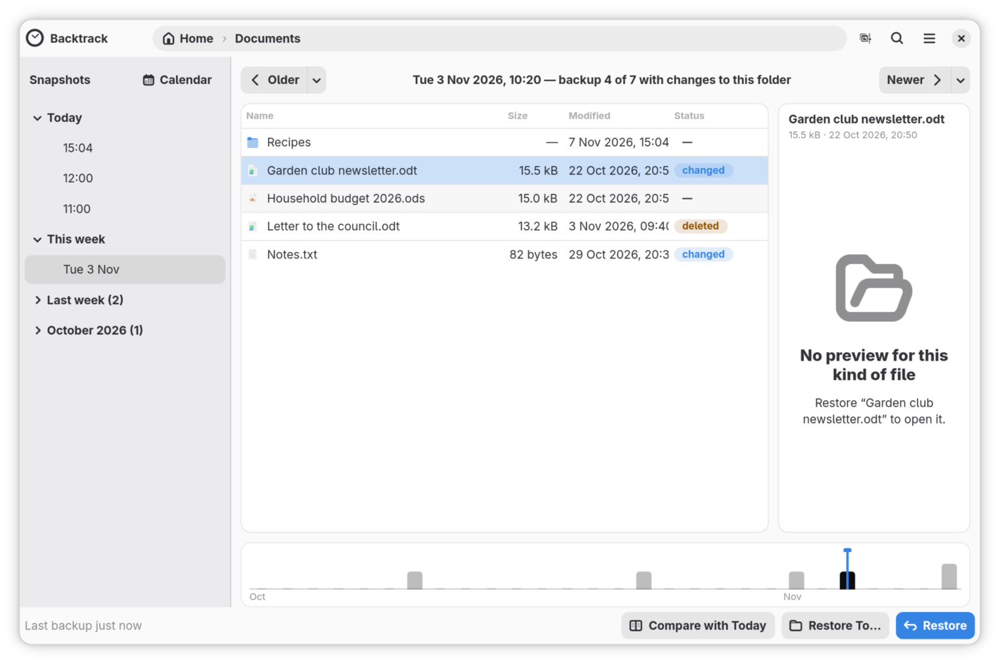
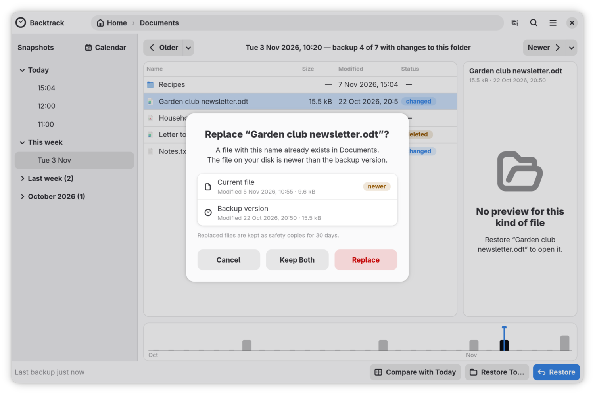
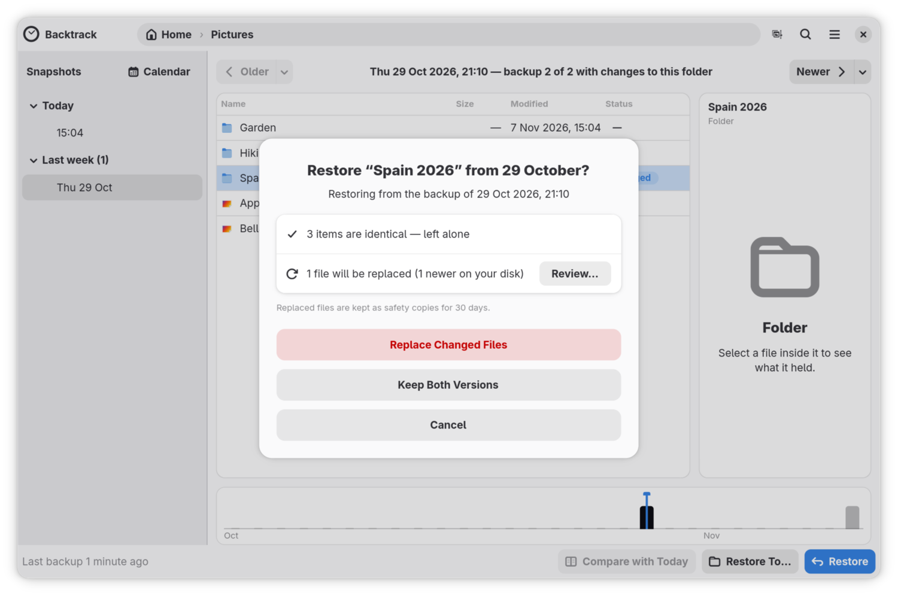
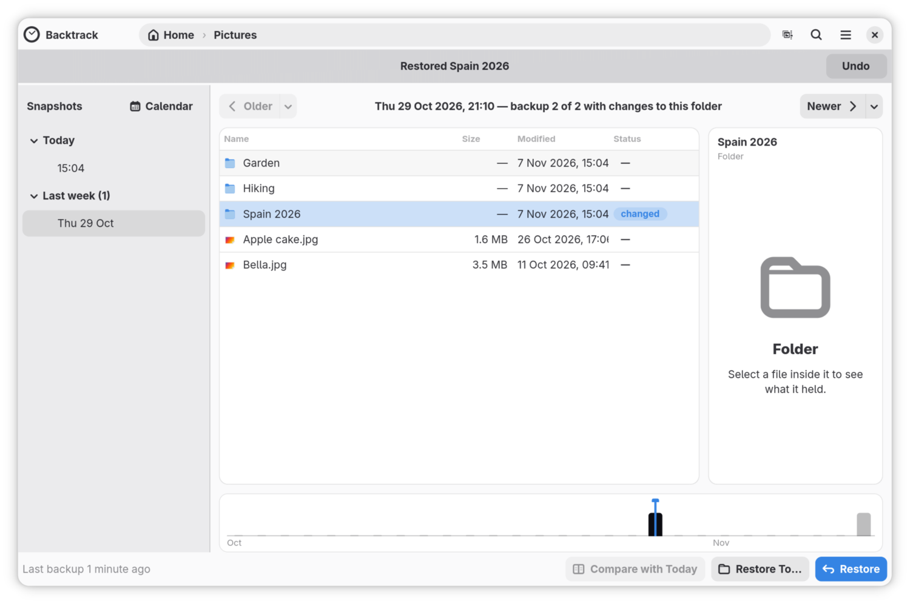

# Get a file back from an earlier backup

Two mistakes happen to everyone: a file deleted, with the Trash emptied
since, and a document saved over with a worse version. Your backups have
both as they were. This guide finds each in an earlier backup and puts it
back, then covers restoring a whole folder, undoing a restore, and restoring
to somewhere else.

## Open the folder in Backtrack

- From GNOME Files or Dolphin, if Backtrack's items are installed
  ([Add Backtrack to your file manager's menu](file-manager-integration.md)):
  right-click the empty space of the folder and choose **Browse Backups of
  This Folder…**, or right-click the spoiled document and choose **Restore
  Previous Version…**, which opens the window with it selected.
- From Backtrack itself, open Backtrack, then double-click your way down
  to the folder. **Alt+Up** goes back up.

The window lists the backups on the left, under **Snapshots**, grouped into
**Today**, **Yesterday**, **This week** and earlier months. The folder's
files are in the middle, and a preview of the selected file is on the right.
The bar along the bottom is the whole history, one mark per day.

## Bring back a deleted file

1. Open the folder the file was in.
2. Click **Older**, or press **Ctrl+Left**, until the file is in the list.
   Each click goes one backup back. The line at the top says which backup
   you are looking at, such as "Wed 12 Jun 2026, 09:00 — backup 3 of 47".
   The list shows only the backups in which this folder changed.

   To go back further in one go, click a backup in the list on the left,
   click **Calendar** and choose a shaded day, or click a day on the bar
   along the bottom.
3. In those backups, the file is marked **deleted**: the newest backup does
   not have it. Click it, and the preview shows it as it was.

   

4. Click **Restore**, or press **Ctrl+R**. The file goes back into its folder
   on your computer. A bar under the header says **Restored** and the file's
   name, with an **Undo** button.

If you do not know which folder the file was in, [Find a lost file with
search](searching.md) finds it by name.

## Bring back a document as it was before a change

1. Open the document's folder, or right-click the document in your file
   manager and choose **Restore Previous Version…**.
2. Click **Older** until the preview shows the version you want. In the
   backups before its last change, the document is marked **changed**: the
   newest backup has a newer version.

   To jump from one version to the next, click the small arrow beside
   **Older** and choose **Previous change to** the document's name. **Newer**
   has **Next change to** in the same place.
3. To see exactly what differs, click **Compare with Today**, or press
   **Ctrl+D**. It shows this version beside the one on your computer, with
   what was added and removed marked.
4. Click **Restore**. Backtrack asks **Replace** and the document's name,
   such as **Replace “newsletter.odt”?**, showing when each copy was last
   changed and which is newer:
   - **Replace** puts the backup's version in its place. The file it
     replaces is kept for 30 days, in case you change your mind.
   - **Keep Both** puts the backup's version under the document's name, and
     renames the one that was there with "(current)" added, such as
     `newsletter (current).odt`.
   - **Cancel** changes nothing.

   

## Restore a whole folder

1. Open the folder, and go back to the backup you want, as above.
2. Click a blank part of the list, so that nothing is selected, and click
   **Restore**. The whole folder is restored. If nothing on your computer is
   in the way, it is restored at once.
3. Otherwise Backtrack asks once for the whole folder. It says how many files
   are identical and left alone, how many would be replaced, how many are
   only in the backup and will be added, and how many are only on your
   computer and kept. Nothing is deleted.

   

4. Choose one:
   - **Keep Both Versions** keeps every file on your computer, with the
     backup's copy beside it, as **Keep Both** does for one file.
   - **Replace Changed Files** puts the backup's copies in their place.
   - **Review…** lists each file that would be replaced. Untick any you want
     left exactly as they are, then click the **Replace** button, which says
     how many files it will replace.
   - **Cancel** changes nothing.

   

## Undo a restore

After a restore, the bar under the header offers **Undo** until you use it or
restore something else. **Undo** puts everything back as it was before the
restore: what it added is removed, what it replaced comes back, and files it
kept both of get their names back.

## Get back a file a restore replaced

Every file a restore replaces is kept for 30 days. If those copies grow past
5 GB, the oldest go sooner.

1. Open the main menu and choose **Recently Replaced Files**. It lists them,
   grouped by when they were replaced.
2. Click **Put Back** beside the one you want. Whatever is in its place now
   is kept here in turn.

## Restore a copy somewhere else

To get an earlier version without touching what is on your computer:

1. Select it in the backup, and click **Restore To…**, or press
   **Ctrl+Shift+R**.
2. Choose a folder, and click **Restore Here**. Backtrack makes a folder
   there named after what you restored and the backup's date, such as
   `Restored website 20 Sep 2026`, and puts the copy inside.

Nothing on your computer is replaced, so there is no question and no Undo.

## If it did not go as described

- **The file is in no backup.** It may have been in a folder you do not back
  up, or existed only between two backups. If it went to the Trash, [Get back
  a file you deleted between two backups](trash.md) can still bring it back.
- **"… isn't in this backup — try a more recent one".** The selected item is
  not in the backup you are looking at. Click **Newer** and try again.
- **"Everything is already up to date".** The backup's copy is the same as the
  one on your computer, so there was nothing to restore.
- **"No preview for this kind of file".** Backtrack previews text and
  pictures only. Restore it, or use **Restore To…** to get a copy you can
  open.
- **The list on the left seems to skip backups.** It shows only the backups
  in which this folder changed. **Show All Backups**, in the main menu, lists
  every one.

## Where to go next

[Find a lost file with search](searching.md), for when you know a file's
name but not where it was.
