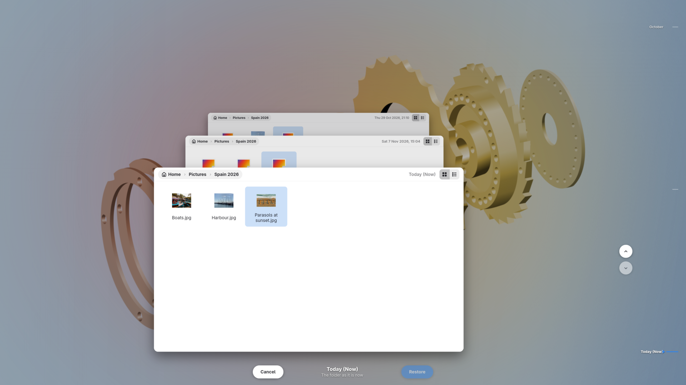

# Go back through a folder's history with Rewind

Rewind fills the screen with a folder as it is now, its backups stretching
away behind it, and a timeline down the side. Going back in time flies the
backups towards you, so you can watch the folder change until it looks the
way you remember. This guide opens Rewind from wherever you are, goes back to
the moment you want, restores a file, and undoes the restore if it was the
wrong one.

## Open Rewind

Choose whichever way is closest:

- In Backtrack's window, click the Rewind button at the top right, choose
  **Rewind…** in the main menu, or press **Ctrl+T**. Rewind opens at the
  folder, backup and file the window is showing.
- In GNOME Files, right-click a file and choose **Rewind This File…**, or
  right-click a folder, or the empty space of the folder you are in, and
  choose **Rewind This Folder…**. In Dolphin, the same items are in the
  **Backtrack** submenu. These need Backtrack's items in your file manager
  ([Add Backtrack to your file manager's menu](file-manager-integration.md)).
- From your desktop's app list or dock, right-click Backtrack's icon and
  choose **Rewind**.
- From the tray, on desktops with one, choose **Rewind…** in Backtrack's
  menu.

Opened from anywhere but the window, Rewind starts at **Today (Now)**: the
folder as it is now.

## Go back to the moment you want

1. Press **Up**, or **Page Up**, or turn the mouse wheel up, to go one backup
   back. **Down** goes one forward. Hold the key down and the stack glides.
   **Home** goes to **Today (Now)** and **End** to the oldest backup.
2. Or use the timeline down the right-hand edge, which has a mark for each
   backup, oldest at the top. Point at it to spread the marks out, rest on
   one to see when it was, and click it to fly there. The arrows beside it go
   one backup older or newer.
3. Under the stack, Rewind says which backup you are looking at, such as "Thu
   5 Nov 2026, 08:26" and "Backup 3 of 8 with changes to this folder". It
   lists only the backups in which the folder changed.

## Find the file

The folder in front shows its files as icons, or as a list with the buttons
in its title bar. A file marked **changed** has a newer version in the latest
backup; one marked **deleted** is not in the latest backup at all.

- Double-click a folder, or select it and press **Enter**, to open it.
- **Alt+Up** goes up a folder.
- **Left** and **Right** move between the icons.
- **Ctrl+H** shows or hides hidden files.

## Restore it

1. Click the file to select it.
2. Click **Restore**, under the stack, or press **Enter**. With nothing
   selected, the whole folder is restored.
3. If something on your computer is in the way, Backtrack asks what to do, as
   it does in the window: **Replace**, **Keep Both** or **Cancel** for one
   file, or one question for a whole folder. [Get a file back from an earlier
   backup](restoring.md) says what each choice does.

When the restore is done, Rewind closes.

## Undo it if it was the wrong one

- If you opened Rewind from the window, the window shows a bar under its
  header with **Undo**. Click it to put things back as they were.
- If you opened it from anywhere else, a notification says what was
  restored, with an **Undo** button, for ten minutes. Clicking the
  notification itself opens Backtrack, with the same bar.

## Leave without restoring

Click **Cancel**, or press **Escape**. Nothing changes. If you opened Rewind
from the window, the window then shows the folder you were looking at in
Rewind.

## If it did not go as described

- **Restore is greyed out.** You are at **Today (Now)**, the folder as it is
  already. Go back at least one backup.
- **Backtrack's window opened instead of Rewind.** Backtrack was still reading
  its list of backups. Try again in a moment.
- **There are no Rewind items in your file manager.** They need installing
  first: see [Add Backtrack to your file manager's
  menu](file-manager-integration.md).

In Dolphin 26.04 and later you can give Rewind's items keyboard shortcuts of
your own, in Dolphin's **Configure Keyboard Shortcuts**.

## Where to go next

[Get back a file you deleted between two backups](trash.md).
