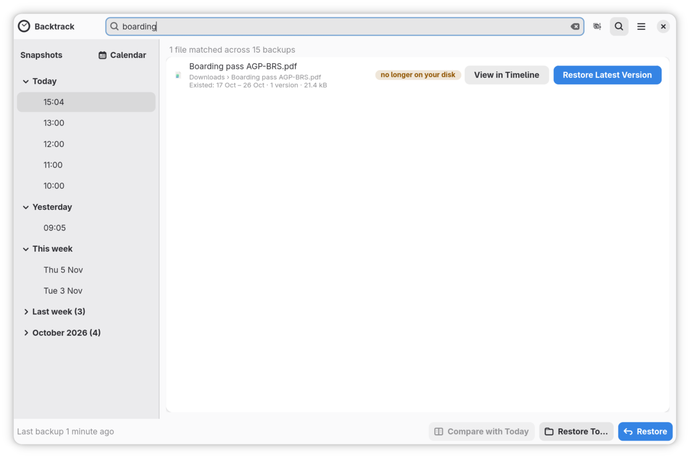
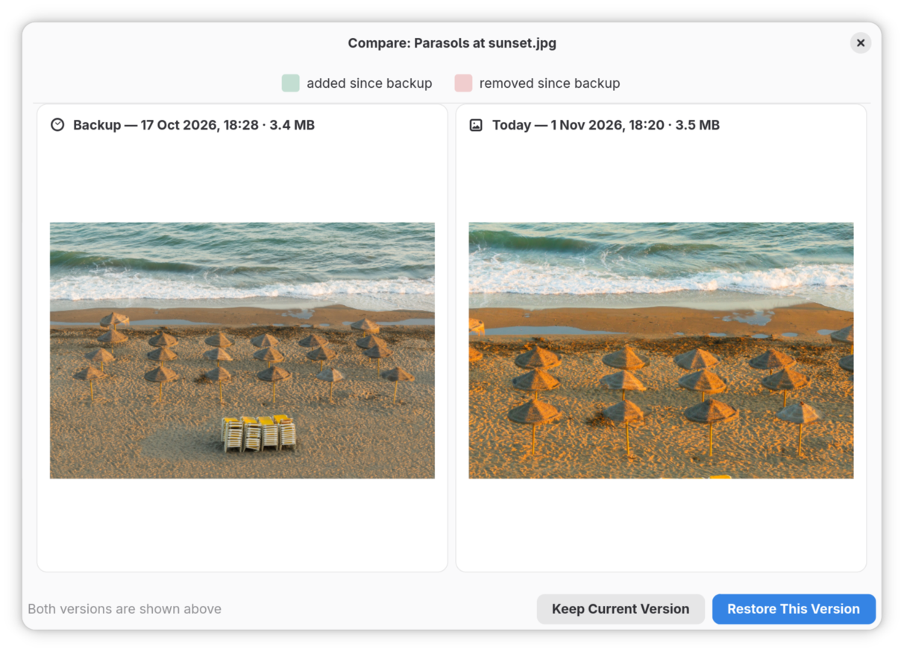
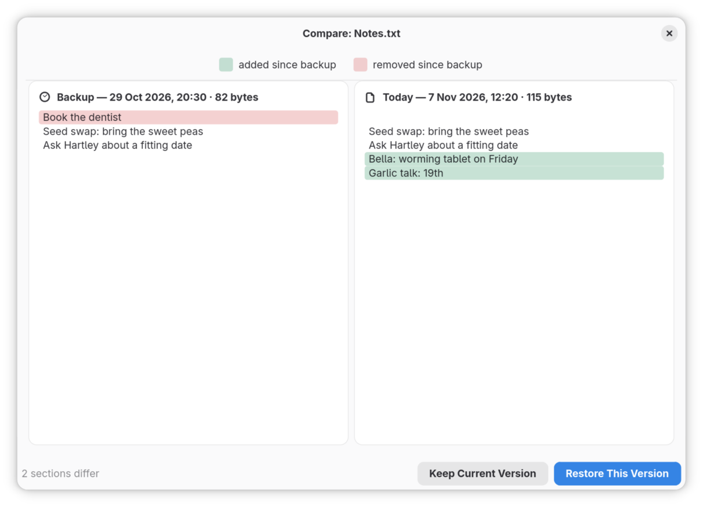

# Find a lost file with search

When you remember a file's name, or part of it, but not where it was or when
it went, search looks through every backup at once. This guide finds a
download that is no longer on your computer and brings it back, then picks
the right version of a photo with **Compare with Today**.

## Find a file that is gone

1. Open Backtrack and click the magnifying glass at the top of the window,
   or press **Ctrl+F**. A search box, **Search every backup**, takes the place
   of the folder's name.
2. Type part of the file's name, two letters or more, such as `boarding`.
   Results appear as you type, with how many files matched across how many
   backups.
3. Read the results. Files that are no longer on your computer come first,
   marked **no longer on your disk**. Under each name is the folder it was
   in, and when it existed, such as "Existed: 26 Jun – 1 Jul · 8 versions ·
   214.0 kB". A file still on your computer ends with "today".

   

4. Click **Restore Latest Version** on the file. Backtrack puts the newest
   copy it has back into the folder it was in, closes the search, and shows
   it there. A bar under the header offers **Undo**.

To look before you restore, click **View in Timeline** instead. It opens the
folder at the last backup that had the file, with the file selected and
shown in the preview. [Get a file back from an earlier
backup](restoring.md) goes on from there.

## Choose the right version of a photo

When a picture has been edited and saved over, search finds it, and **Compare
with Today** shows each earlier version beside the one you have now.

1. Search for the picture as above, and click **View in Timeline**.
2. Click **Older** to go back one backup at a time. The preview shows the
   picture as each backup has it.
3. When the preview looks right, click **Compare with Today**, or press
   **Ctrl+D**. A window shows the backup's version on the left and today's on
   the right, each with its date and size.

   

4. If it is the one you want, click **Restore This Version**. If not, click
   **Keep Current Version** to close the window, go back another backup, and
   compare again.
5. Since the picture is still on your computer, Backtrack asks whether to
   **Replace** it or **Keep Both**. **Keep Both** keeps the edited picture
   too, with "(current)" added to its name.

**Compare with Today** works on documents too. For a text file it shows the
two versions side by side, with what was added since the backup and what was
removed marked in colour, and says how many sections differ. Other files it
cannot show side by side, but it still says whether the two differ.

## If it did not go as described

- **"Nothing found".** No file in any backup has a name with those letters.
  Try fewer of them, or another part of the name. A file in a folder you do
  not back up is in no backup.
- **There is no Restore Latest Version button.** The file is still on your
  computer. Use **View in Timeline** to find an earlier version.
- **Compare with Today is greyed out.** It needs a file, not a folder, that is
  still on your computer, while you are looking at a backup.
- **"Search needs the background service".** The part of Backtrack that runs
  in the background is not running. Logging out and back in starts it again.

## Where to go next

[When Backtrack needs you](when-backtrack-needs-you.md), on what Backtrack's
warnings mean.
