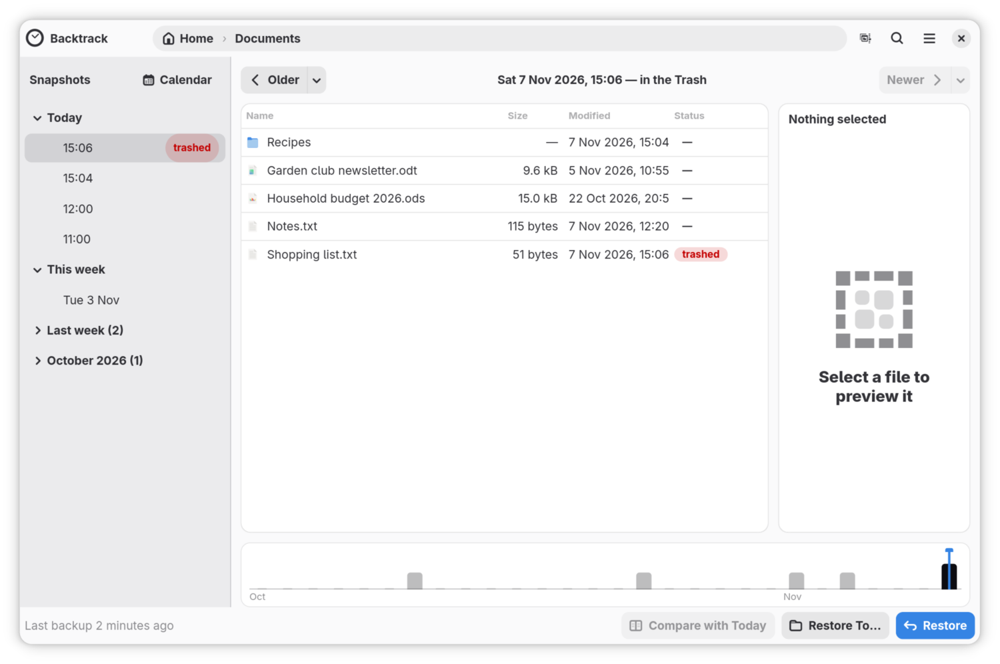

# Get back a file you deleted between two backups

Backtrack backs up every hour, so a file you write at 12:15 and delete at
12:45 is in no backup: it was not there at 12:00, and was gone by 13:00. If
you deleted it by moving it to the Trash, though, the Trash still has it, and
Backtrack shows it in its timeline until the Trash is emptied. This guide
gets such a file back, and puts it back in the Trash if you change your mind.

## Get it back

1. Open the folder the file was in, in Backtrack's window. In GNOME Files or
   Dolphin, right-click the folder's empty space and choose **Browse Backups
   of This Folder…**.
2. In the list of backups on the left, find the one marked **trashed**, at
   about the time you deleted the file. Something deleted since the last
   backup is at the top, above the newest backup. Click it.

   

3. The folder appears as it was just before, with what went to the Trash back
   in its place, marked **trashed**. Click the file: the preview shows the
   Trash's copy.
4. Click **Restore**, or press **Ctrl+R**. The file leaves the Trash and goes
   back where it was, as your file manager's own **Restore** would. If
   something else now has its name, Backtrack asks whether to **Replace** it
   or **Keep Both**, as for any restore.
5. A bar under the header says what was restored, with **Undo**.

None of this needs your backup drive: the Trash is on this computer.

## Put it back in the Trash

Click **Undo** on the bar. The file goes back into the Trash, with the time
you first deleted it, and its entry comes back in the list. If something
else with the same name has gone into the Trash since, it goes back beside it
with `.2` added to its name. Undo never deletes anything that came from the
Trash.

## A whole folder

Restoring a whole folder from a **trashed** entry brings back both halves in
one go: what the backup before had, and what went to the Trash since.
Backtrack asks once, as it does for any folder ([Get a file back from an
earlier backup](restoring.md#restore-a-whole-folder)).

## Find it by name

[Search](searching.md) finds what is in the Trash as well. A file that no
backup has says "Moved to the Trash" with the date and time, and "in no
backup". **Restore Latest Version** brings it back.

## What the Trash cannot bring back

- Anything that never reached the Trash, or has left it: a file deleted
  with Shift+Delete or from a terminal, or a Trash that has been emptied.
- The earlier of two copies. If the same file went to the Trash twice
  between two backups, Backtrack shows the later copy. Your file manager's
  Trash still has both.
- Another drive's Trash, unless that drive holds a folder you back up.
- Files from places you do not back up, which Backtrack leaves out here
  too.
- A file inside a folder that went to the Trash, by searching for its
  name. Search for the folder instead, or open its **trashed** entry and
  look inside.

## If it did not go as described

- **There is no trashed entry.** Either nothing went to the Trash from this
  folder that a backup does not already have, or the Trash has been emptied.
  If the file was unchanged since a backup, that backup has it: [Get a file
  back from an earlier backup](restoring.md).
- **The entry is there but the folder looks empty.** It says "Nothing from
  the Trash here": what went to the Trash then came from another folder.
  Open that folder instead.

[How Backtrack reads the Trash](trash-internals.md) explains the details,
for developers.

## Where to go next

[Find a lost file with search](searching.md).
